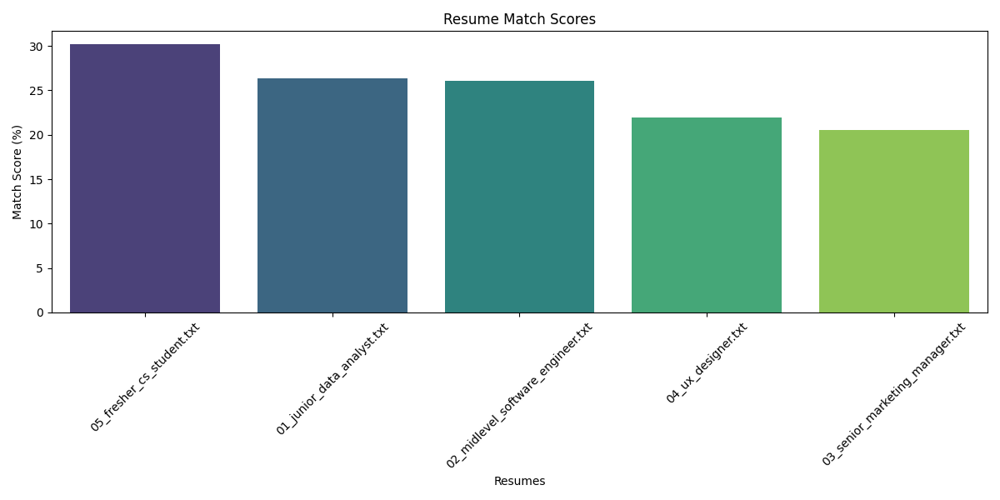

# AI Resume Analyzer & Job Matchmaking

A Google Colab project that compares resumes with a job description using keyword and semantic similarity, identifies skill gaps, and requests resume suggestions from a Hugging Face language model.

## What it does

- Extracts text from PDF, Word, and plain-text resumes
- Computes TF-IDF and Sentence Transformer similarity scores
- Finds matched and missing skills using a predefined skill list
- Estimates experience gaps with regular expressions
- Generates optional LLM suggestions
- Exports a CSV report and a comparison chart to Google Drive

The scores are heuristic comparisons, not validated measures of candidate suitability. Review results manually.

## Technology

Python, scikit-learn, Sentence Transformers (`all-MiniLM-L6-v2`), PyPDF2, textract, pandas, matplotlib, seaborn, and Hugging Face inference.

## Run in Google Colab

1. Open [the notebook](notebook/Resume_Analyzer_v2_Enhanced_Edition.ipynb) in Google Colab.
2. Run the installation cells and mount Google Drive when prompted.
3. Supply your own Hugging Face access token through the `HF_TOKEN` environment variable or the hidden prompt. Never save it in a notebook cell.
4. Upload sample resumes and edit the job-description text.
5. Run the analysis cells to view scores and export results.

The model endpoint requires suitable access and availability on Hugging Face. Suggestions may be unavailable if the endpoint or token cannot be used.

## Clone the repository

```bash
git clone https://github.com/patelmup1/AI-Based-Resume-Analyzer-for-Job-Matchmaking.git
cd AI-Based-Resume-Analyzer-for-Job-Matchmaking
```

## Repository guide

- [notebook/Resume_Analyzer_v2_Enhanced_Edition.ipynb](notebook/Resume_Analyzer_v2_Enhanced_Edition.ipynb): Colab notebook
- [src/resume_analyzer_v2_enhanced_edition.py](src/resume_analyzer_v2_enhanced_edition.py): exported Colab source
- [data](data): sample resume text files
- [screenshots,example](screenshots,example): example reports and charts
- [requirements.txt](requirements.txt): dependency list

The exported Python file contains Colab/IPython shell commands and Google Drive integrations. It cannot currently be run directly with `python src/resume_analyzer_v2_enhanced_edition.py`. The pinned requirements are not a verified standalone installation path.

## Example output



## Data and credentials

Use sample or consented resumes. LLM suggestions transmit resume excerpts and the job description to the configured inference service. A previously committed Hugging Face token must be revoked by the owner; removing it from the current source does not remove it from Git history.

## Feedback

Report bugs through [GitHub Issues](https://github.com/patelmup1/AI-Based-Resume-Analyzer-for-Job-Matchmaking/issues).

## License

No LICENSE file is currently included in this repository. Licensing terms need to be specified by the maintainer.
